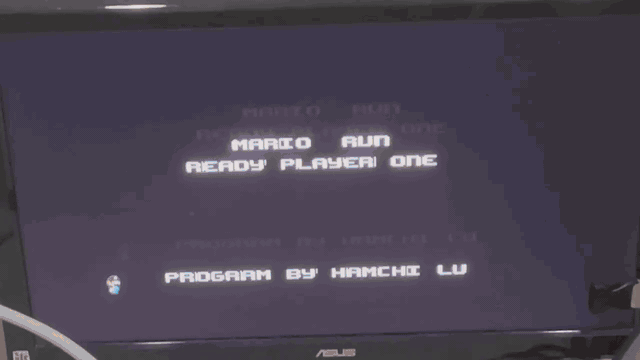
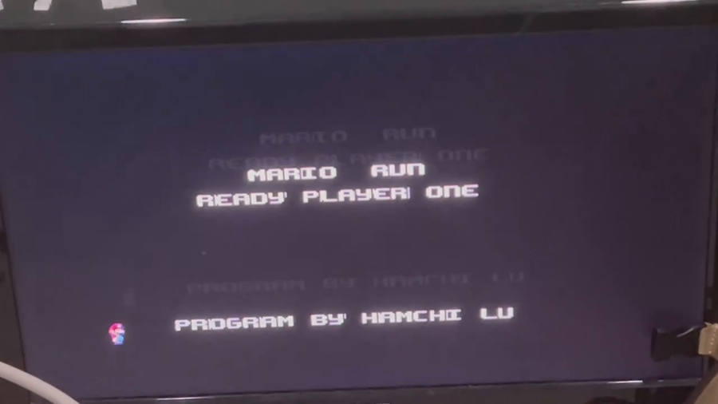
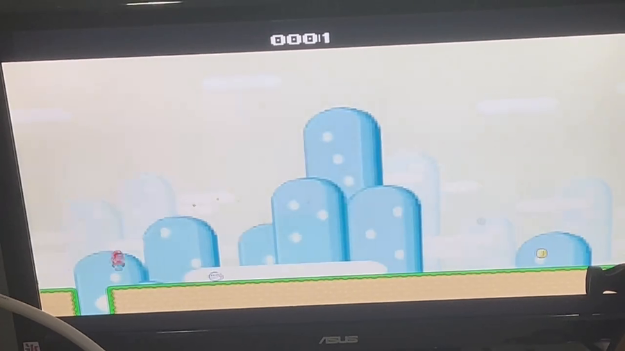
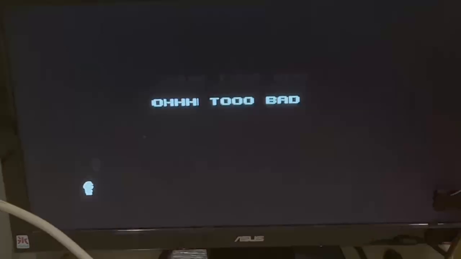
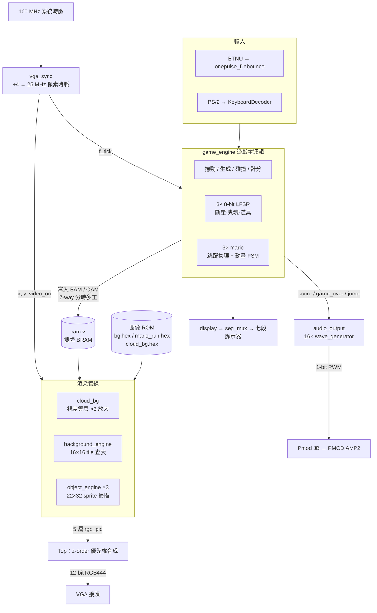

# Mario Run — FPGA 硬體橫向捲軸遊戲

> 以 **純 Verilog RTL** 在 Xilinx Artix-7 FPGA 上從零打造的橫向捲軸跑酷遊戲：
> 自製 VGA 顯示控制器、五層圖層合成引擎、tile／sprite 渲染管線、16 聲道 PWM 音訊合成器，
> 以及一條把 PNG／MIDI 轉成硬體 ROM 的 Python 資產管線。
> **沒有使用任何軟核心 CPU 或作業系統，所有遊戲邏輯都在時序電路中執行。**

<p align="center">
  <br>
  <sub>▲ Basys 3 實機執行畫面：開場 → 遊玩 → Game Over（VGA 輸出至外接螢幕）</sub>
</p>

| 項目 | 內容 |
|---|---|
| 開發平台 | Digilent **Basys 3**（Xilinx **Artix-7 XC7A35T-1CPG236C**） |
| 開發語言 | Verilog-2001（**約 2,900 行 RTL**，24 個模組） |
| 開發工具 | Vivado Design Suite、Python 3（Pillow / mido） |
| 顯示輸出 | VGA **640×480 @ 60 Hz**，12-bit RGB444 |
| 音訊輸出 | Pmod JB → PMOD AMP2，**1-bit PWM** |
| 輸入裝置 | 板載按鈕（消彈跳）、PS/2 鍵盤（USB HID） |
| 專案性質 | 大學二年級數位邏輯設計課程專題 |

---

## 目錄

- [遊戲玩法](#遊戲玩法)
- [系統架構](#系統架構)
- [核心技術實作](#核心技術實作)
- [模組總覽](#模組總覽)
- [硬體接腳配置](#硬體接腳配置)
- [建置與燒錄](#建置與燒錄)
- [技術挑戰與解決方案](#技術挑戰與解決方案)
- [專案結構](#專案結構)
- [已知限制與未來工作](#已知限制與未來工作)
- [授權與素材聲明](#授權與素材聲明)

---

## 遊戲玩法

開機後先播放 **5 秒開場畫面**（`splash.bin`，顯示 `MARIO RUN` / `READY PLAYER ONE`），接著進入遊戲。玩家操控 **一列三隻角色組成的隊伍**，在無限向左捲動的地形上奔跑：

| 元素 | 行為 |
|---|---|
| 🏃 **三人隊伍** | 三隻角色前後相隔 22 px 排成一列。按下跳躍鍵時，**後方角色會延遲 100 ms 才起跳**，形成連鎖跳躍的視覺效果 |
| 🕳️ **斷崖** | 由 LFSR 產生隨機間距的地板缺口，掉出畫面下緣的角色死亡 |
| 👻 **鬼魂** | 從畫面右側隨機位置生成並向左移動，碰到即造成該角色死亡 |
| 🍄 **復活道具** | 吃到後**復活一名已死亡的隊員**（採「先復活編號最小者」的優先順序） |
| 🪙 **金幣** | 4 幀循環動畫，吃到 +1 分並播放音效，之後在隨機位置重生 |
| 💀 **Game Over** | 三名角色全數死亡後切換至 `OHHH TOOO BAD` 畫面（`game_over.bin`），並播放 7 聲道結束音樂 |

**難度遞增機制**：捲動週期從 10 ms／px 起算，每得 10 分縮短 1 ms，下限 2 ms
→ 遊戲速度從 **100 px/s 平滑加速到 500 px/s**（約在 80 分時達到上限）。

### 操作

| 輸入 | 功能 |
|---|---|
| `BTNU`（T18） | 跳躍 |
| `BTNC`（U18） | 重置遊戲 |
| 空白鍵（PS/2） | 跳躍（解碼器已實作，預設未啟用，詳見[已知限制](#已知限制與未來工作)） |
| 四位七段顯示器 | 顯示遊戲進行時間（分:秒） |
| 畫面上方 HUD | 顯示 4 位數分數 |

### 遊戲畫面

| 開場畫面 | 遊玩畫面 | Game Over |
|:--:|:--:|:--:|
|  |  |  |
| `MARIO RUN` / `READY PLAYER ONE`<br>由 `splash.bin` tilemap 繪製 | 視差雲層、斷崖、金幣<br>與 HUD 分數 | `OHHH TOOO BAD`<br>由 `game_over.bin` tilemap 繪製 |

> 以上皆為 **Basys 3 實機執行、VGA 輸出至外接螢幕**的拍攝畫面（非模擬器）。
> 文字的輕微殘影來自相機快門與 60 Hz VGA 更新的頻率干涉，實際觀看時畫面是穩定的。

---

## 系統架構

整個設計是一條 **以 VGA 掃描座標 `(x, y)` 為驅動核心的即時渲染管線**：`vga_sync` 每個像素時脈產生一組座標，所有渲染模組同時對該座標求值，最後由 `Top` 依 z-order 決定輸出顏色。遊戲邏輯則在背景以不同的時間尺度改寫記憶體內容。



---

## 核心技術實作

### 1. VGA 時序產生器

[`src/vga_sync.v`](src/vga_sync.v) 以參數化方式完整實作 VESA 640×480@60Hz 規格，不依賴任何 IP core：

```verilog
parameter H_MAX = 640 + 48 + 16 + 96 - 1;   // 799：可視 + 左右邊界 + 水平回歸
parameter V_MAX = 480 + 10 + 33 +  2 - 1;   // 524：可視 + 上下邊界 + 垂直回歸
```

- 用 2-bit 計數器把 100 MHz 除頻為 **25 MHz 像素時脈**（`pixel_tick = (pixel_reg == 0)`）
- `hsync` / `vsync` 為低態有效，皆經暫存器輸出以避免組合邏輯毛刺
- 額外輸出 `f_tick`（`x == 0 && y == 0`）作為**幀同步脈衝**，供遊戲邏輯使用

### 2. 五層圖層合成器

[`src/Top.v`](src/Top.v) 維護一組 `rgb_pic[0:4]` 與 `layer_on[0:4]`，在每個時脈以迴圈掃描，**索引大者覆蓋索引小者**，等效於硬體 z-order：

```verilog
for (z_index = 0; z_index < LAYERS; z_index = z_index + 1)
    if (layer_on[z_index]) rgb_reg <= rgb_pic[z_index];
```

| 層 | 內容 | 說明 |
|:--:|---|---|
| 0 | 視差雲層 | 213×160 圖像以 `/3` 放大填滿畫面 |
| 1 | Tile 背景 | 地板、斷崖、金幣、鬼魂、道具、分數 HUD |
| 2–4 | 三個角色 sprite | 各自獨立的 OAM 與繪製通道 |

**視差捲動**巧妙地把 tile 子像素偏移量的最低位元 `bg_x_offset[0]` 當作時脈來源，讓雲層自然地以前景 1/16 的速率移動，不需額外的除頻器：

```verilog
always @ (posedge bg_x_offset[0])   // 製造比前景慢的位移
    cloud_x_offset <= (cloud_x_offset == 639) ? 0 : cloud_x_offset + 1;
```

### 3. Tile 背景引擎（BAM）

[`src/background_engine.v`](src/background_engine.v) 實作類似 NES／SNES PPU 的 **tile-based 背景**：

- 畫面切成 **40 × 30 = 1,200 個 16×16 tile**
- **BAM（Background Attribute Memory）** 存於雙埠 BRAM，每格僅 **9 bits**
  → 整張地圖只需約 **1.35 KB**，而非 640×480×12 bits（450 KB）的 framebuffer
- 圖磚素材為 128×128 的 **8×8 tile atlas**（`bg_sprites.bmp`）

| 位元 | 欄位 | 說明 |
|:--:|---|---|
| `[8]` | `ENABLE` | 該格是否繪製（0 = 透明） |
| `[7]` | `Y_FLIP` | 垂直翻轉 |
| `[6]` | `X_FLIP` | 水平翻轉（斷崖左右邊緣共用同一張圖磚） |
| `[5:3]` | `TILE_ROW` | atlas 列索引 |
| `[2:0]` | `TILE_COL` | atlas 行索引 |

渲染時以純組合邏輯完成位址計算與翻轉，並支援**次像素平滑捲動**（`x_offset` 為 0–15 的子 tile 偏移）；`y <= 70` 的 HUD 區域則強制 `x_offset = 0` 保持靜止。色鍵 `12'h00f` 作為透明色。

### 4. Sprite 物件引擎（OAM）

[`src/object_engine.v`](src/object_engine.v) 實作 **OAM（Object Attribute Memory）** 掃描，每個角色為 22×32 像素、可從 sprite sheet 任選幀：

| 位元 | 欄位 |
|:--:|---|
| `[31]` | 顯示致能 |
| `[26]` | X_FLIP |
| `[25:16]` | 物件座標 X（10 bits） |
| `[15:6]` | 物件座標 Y（10 bits） |
| `[5:3]` | sprite sheet 列 |
| `[2:0]` | sprite sheet 行 |

模組內建 8 筆 OAM cache，每個時脈同時比對所有項目是否落在當前掃描座標範圍內，命中則計算 ROM 位址並取色；`in_range` 位元向量供 `Top` 判斷該層是否需要顯示。

### 5. 遊戲主邏輯引擎

[`src/game_engine.v`](src/game_engine.v)（479 行）是整個專案邏輯最密集的部分。

**分時多工的 BAM 寫入** — 單一 BRAM 寫入埠被 **7 個資料來源**共用，以 `bam_counter` 劃分時間片，讓各繪圖來源依序取得寫入權：

```
counter 0–2049     → 地板／斷崖重繪
counter 2050–2063  → 分數 HUD（4 位數字）
counter 2064–2099  → 金幣
counter 2300–2499  → 鬼魂
counter 2500–2699  → 復活道具
```

**硬體亂數** — 三組獨立的 8-bit LFSR（多項式 `x^8 + x^6 + 1`）分別驅動斷崖間距、鬼魂重生位置與道具重生位置，零成本取得可重現的偽隨機序列：

```verilog
lfsr_cliff <= {lfsr_cliff[6:0], lfsr_cliff[7] ^ lfsr_cliff[5]};
```

**跳躍物理**（[`src/mario.v`](src/mario.v)）— 以「上升／下降」兩態 FSM 搭配變動的時間常數模擬重力：上升段的 `jump_t` 逐步遞增（越接近頂點越慢），下降段則遞減（越掉越快），實作出拋物線手感。另設 `COOL_DOWN_TIME` 冷卻計時器防止連跳。

**隊伍連鎖跳躍** — 每個角色持有一個 `mario_num` 延遲槽位，跳躍觸發條件為：

```verilog
assign can_jump = (timer == 32'd10_000_000 * (mario_num - 1));   // 每槽位延遲 100 ms
```

死亡與復活時，`mario_delay_idx` 組合邏輯會依 `{dead[2], dead[1], dead[0]}` 的 8 種狀態**重新分配延遲槽位**，確保隊伍缺人時仍維持等距的連鎖節奏。

### 6. 16 聲道 PWM 音訊合成器

[`src/audio_unit.v`](src/audio_unit.v)（1,088 行）在**完全沒有 DAC** 的情況下產生多聲部音樂：

- **`wave_generator`**：64 點正弦波查表（有號 8-bit，振幅 ±63）。以除頻計數器控制查表推進速率，音高由 16-bit 除頻值決定
  → `divisor = 100 MHz / (f × 64)`，因此一個完整波形週期恰為 `1/f` 秒
- **16 個獨立聲道**，依遊戲情境切換混音來源：

| 情境 | 聲道數 | 用途 |
|---|:--:|---|
| 背景音樂 | 3 | 主旋律 + 副旋律 + 低音（165 拍循環） |
| 跳躍音效 | 3 | 最高優先權，可打斷 BGM |
| Game Over | **7** | 七聲部和聲 |
| 得分音效 | 3 | 由 `score` 上升緣觸發 |

- **混音與輸出**：多聲道波形直接相加為有號 12-bit，平移為無號後與 10-bit 遞增計數器比較，產生 **1-bit PWM** 位元流送往 Pmod AMP2（`pmod_2` = 增益設定，`pmod_4` = 電源致能）

```verilog
assign positive_wave_sum = wave_sum * 2 + 512;
if (PWM < $unsigned(positive_wave_sum)) out <= 1; else out <= 0;
PWM <= PWM + 1;
```

- **樂譜格式**：每個音符為 32-bit —— 高 16 bits 是除頻值、低 16 bits 是毫秒音長。播放器以 `PLAY_DELAY = 100_000`（100 MHz ÷ 100k = **1 kHz**）遞減音長，使「毫秒」單位與硬體計時精確對齊

### 7. Python 資產管線

`resource/` 內的兩支腳本把美術與音樂素材自動轉為可合成的 Verilog。

**[`img_process.py`](resource/img_process.py)** — 圖像 → ROM

```bash
python img_process.py super_mario_run.png mario_run --width 110 --height 64 --file mario_run.hex
```

- 將 24-bit RGB 量化為 **12-bit RGB444**（`r // 16`）
- 依圖片尺寸自動計算所需位址位元數，**同時產生 `.hex` 記憶體檔與對應的 Verilog ROM wrapper**（含 `(* rom_style="block" *)` 屬性，強制推論為 BRAM）
- `--mono` 模式可將單色圖壓成 1 bit／pixel

**[`music_process.py`](resource/music_process.py)** — MIDI → 樂譜陣列

```bash
python music_process.py music.mid 1
```

- 用 `mido` 解析 MIDI 音軌，追蹤同時發聲的音符數以決定所需聲道數
- 透過 `midi_note.dat`（MIDI 音高 → 頻率對照表）換算除頻值
- 以 `tick2second` 把 MIDI tick 轉為毫秒，輸出 `track_{n}_ch_{m}.hex`

---

## 模組總覽

| 模組 | 檔案 | 職責 |
|---|---|---|
| `Top` | [src/Top.v](src/Top.v) | 頂層整合、圖層合成、封面／遊玩／Game Over 狀態機 |
| `vga_sync` | [src/vga_sync.v](src/vga_sync.v) | 640×480@60Hz 時序與掃描座標產生 |
| `background_engine` | [src/background_engine.v](src/background_engine.v) | BAM 屬性解碼、tile atlas 查表、翻轉與色鍵 |
| `object_engine` | [src/object_engine.v](src/object_engine.v) | OAM cache 掃描、sprite 命中判定與取色 |
| `game_engine` | [src/game_engine.v](src/game_engine.v) | 捲動、地形生成、碰撞、計分、BAM 寫入排程 |
| `mario` | [src/mario.v](src/mario.v) | 單一角色的跳躍物理與 5 幀跑步動畫 FSM |
| `ram` | [src/ram.v](src/ram.v) | 參數化簡易雙埠 BRAM（BAM／OAM／封面／Game Over） |
| `audio_output`<br>`wave_generator` | [src/audio_unit.v](src/audio_unit.v) | 16 聲道波表合成、情境混音、1-bit PWM 輸出 |
| `vga_num` | [src/vga_num.v](src/vga_num.v) | 16-bit 分數 → 4 個數字 tile 寫入 BAM |
| `game_over_text` | [src/game_over_text.v](src/game_over_text.v) | 以字形 tile 拼出文字（改用點陣圖後保留） |
| `display`<br>`seg_mux`<br>`bcd_7seg_anode` | [src/display.v](src/display.v)<br>[src/seg_mux.v](src/seg_mux.v)<br>[src/bcd_7seg.v](src/bcd_7seg.v) | 四位七段顯示器的分時掃描與解碼 |
| `clock_normal`<br>`clock_div`<br>`clock_div_n` | [src/clock_div.v](src/clock_div.v) | 遊戲計時（分:秒）與各級除頻 |
| `KeyboardDecoder` | [src/KeyboardDecoder.v](src/KeyboardDecoder.v) | PS/2 掃描碼 FSM（含 extend／break code 處理） |
| `onepulse_Debounce`<br>`OnePulse` | [src/Debounce.v](src/Debounce.v)<br>[src/OnePulse.v](src/OnePulse.v) | 4 級移位暫存器消彈跳、上升緣單脈衝 |
| `bg_rom`／`mario_run`／`cloud_bg` | `src/*.hex.v` | **由 Python 自動產生**的圖像 ROM wrapper |

---

## 硬體接腳配置

完整定義於 [`src/vga_cons.xdc`](src/vga_cons.xdc)。

| 功能 | 接腳 |
|---|---|
| 系統時脈 100 MHz | `W5` |
| VGA RGB444（12 bits） | `G19 H19 J19 N19`（R）／`N18 L18 K18 J18`（G）／`J17 H17 G17 D17`（B） |
| VGA `hsync`／`vsync` | `P19`／`R19` |
| 按鈕：重置／跳躍／下／左／右 | `U18`／`T18`／`U17`／`W19`／`T17` |
| 七段顯示器 `seg[6:0]`／`ano[3:0]` | `U7 V5 U5 V8 U8 W6 W7`／`U2 U4 V4 W4` |
| Pmod JB（音訊） | `A14`（PWM out）／`A16`（gain）／`B16`（enable） |
| PS/2 `CLK`／`DATA` | `C17`／`B17`（含 pull-up） |

---

## 建置與燒錄

### 需求

- Vivado Design Suite 2018.2 以上
- Digilent Basys 3 開發板
- VGA 螢幕與訊號線
- （選用）Pmod AMP2 音訊模組、PS/2 或 USB 鍵盤
- （僅重新產生素材時需要）Python 3 + `pillow`、`mido`

### 步驟

1. Vivado → **Create Project** → RTL Project，Part 選 `xc7a35tcpg236-1`（或直接選 Basys 3 board file）
2. **Add Sources** → 加入 `src/` 內全部 `.v` 檔
3. **Add Constraints** → 加入 `src/vga_cons.xdc`
4. **Add Sources → Add or create design sources** → 把 `src/*.hex` 與 `src/*.bin` 一併加入專案
5. Run Synthesis → Implementation → Generate Bitstream
6. **Open Hardware Manager** → Program Device

### ⚠️ 建置注意事項

- **記憶體初始化檔的搜尋路徑**：所有 ROM／RAM 皆以 `$readmemh("xxx.hex", ...)` 的**相對路徑**載入。若合成時出現 `Failed to open file` 警告（表現為畫面全黑或彩色雜訊），請將 `src/*.hex`、`src/*.bin` 複製到對應的 `<project>.runs/synth_1/` 與 `impl_1/` 目錄下。
- **PS/2 鍵盤相依性**：`KeyboardDecoder` 內部實例化的 `KeyboardCtrl_0` 為外部 IP core，未包含於本 repo。若不需要鍵盤輸入可直接忽略（預設即未啟用），板載按鈕已能完整遊玩。

---

## 技術挑戰與解決方案

| 挑戰 | 解決方案 |
|---|---|
| **記憶體不足以放下 framebuffer**<br>640×480×12 bits = 450 KB，遠超 Artix-7 XC7A35T 可用的 BRAM 容量 | 改採 **tile-based 渲染**：只儲存 40×30 格、每格 9 bits 的屬性表（約 1.35 KB），像素顏色即時從 tile atlas ROM 查表產生，記憶體用量降為原本的 **1/300** |
| **BRAM 讀取延遲會撕裂畫面**<br>同步 BRAM 有 1–2 個時脈的讀取延遲，與 VGA 逐像素掃描不同步 | 統一將 `ram.v` 設為 `HIGH_PERFORMANCE`（兩級輸出暫存器），並讓渲染管線的位址計算提前於取色一個週期，使延遲在整條管線中保持一致 |
| **單一寫入埠 vs. 多個繪圖來源**<br>地板、分數、金幣、鬼魂、道具都要寫同一塊 BAM | 以 `bam_counter` 實作**分時多工排程器**，把每輪更新切成固定時間片依序授權寫入，避免仲裁邏輯與寫入衝突 |
| **每幀重繪整張地圖太慢** | 捲動時只重繪地板列（120 格）與少數動態物件，其餘 tile 保持不動；並以獨立的 `clear_bg` 通道處理清除 |
| **沒有硬體乘法器可用的亂數來源** | 三組 8-bit **LFSR**，單一 XOR 閘即可產生長週期的偽隨機序列 |
| **FPGA 沒有 DAC，如何播放多聲部音樂** | **正弦波查表 + 多聲道相加 + 1-bit PWM**：16 個 `wave_generator` 各自產生波形，相加後以 10-bit PWM 調變輸出，靠喇叭的低通特性還原為類比音訊 |
| **視差捲動需要第二組較慢的時脈** | 直接把 tile 子像素偏移量的最低位元 `bg_x_offset[0]` 當作時脈邊緣來源，免除額外除頻器 |
| **三個角色的動作要有時間差** | 為每個角色配置延遲槽位 `mario_num`，跳躍觸發條件改為 `timer == 100 ms × (mario_num - 1)`；並用組合邏輯依存活狀態動態重排槽位 |

---

## 專案結構

```
HD_zombierun/
├── docs/                       # 實機錄影 GIF 與截圖
│
├── src/                        # 可合成的 RTL 與記憶體初始化檔
│   ├── Top.v                   # 頂層：圖層合成 + 遊戲狀態機
│   ├── vga_sync.v              # VGA 640×480@60Hz 時序產生器
│   ├── game_engine.v           # 遊戲主邏輯（479 行）
│   ├── mario.v                 # 角色跳躍物理與動畫 FSM
│   ├── background_engine.v     # Tile 背景渲染
│   ├── object_engine.v         # Sprite 物件渲染
│   ├── audio_unit.v            # 16 聲道 PWM 音訊合成（1,088 行）
│   ├── ram.v / text.v          # 參數化雙埠 BRAM
│   ├── clock_div.v             # 除頻與遊戲計時
│   ├── display.v / seg_mux.v / bcd_7seg.v            # 七段顯示器
│   ├── KeyboardDecoder.v / Debounce.v / OnePulse.v   # 輸入處理
│   ├── vga_num.v / game_over_text.v                  # HUD 數字與文字
│   ├── *.hex / *.hex.v         # 圖像 ROM 資料與自動產生的 wrapper
│   ├── splash.bin              # 開場封面 tilemap
│   ├── game_over.bin           # Game Over 畫面 tilemap
│   └── vga_cons.xdc            # Basys 3 接腳約束
│
└── resource/                   # 素材原檔與資產管線
    ├── img_process.py          # PNG/BMP → 12-bit RGB .hex + Verilog ROM
    ├── music_process.py        # MIDI → {除頻值, 音長} 樂譜陣列
    ├── *.bmp / *.png           # 原始圖磚、sprite sheet、字型
    ├── *.mid / *.midi          # 背景音樂與音效原檔
    ├── midi_note.dat           # MIDI 音高 → 頻率對照表
    └── map.tbl                 # 字元 → 字型 tile 座標對照表
```

---

## 已知限制與未來工作

誠實紀錄目前的狀態，以及若要延續開發會優先處理的項目：

- **PS/2 鍵盤輸入未啟用**：`KeyboardDecoder` 已完整實作 PS/2 掃描碼 FSM，`mario.v` 內也保留了空白鍵的解碼路徑，但因外部 IP `KeyboardCtrl_0` 未納入版控，目前實例化的部分被註解停用，實際輸入來源為板載按鈕。
- **記憶體初始化檔的路徑相依**：`$readmemh` 使用相對路徑，換到不同的 Vivado 專案目錄結構時需手動複製檔案（見[建置注意事項](#️-建置注意事項)）。改用 Block Memory Generator IP 或 `.coe` 檔可根除此問題。
- **`game_over_text` 模組未接線**：Game Over 畫面最終改以預先轉檔的 `game_over.bin` tilemap 呈現，這個以字型 tile 動態拼字的模組因而保留但未啟用。
- **`vga_cons.xdc` 有殘留的接腳定義**：`up` 與 `up_button` 皆指向 `T18`，其中 `up` 在頂層已改為內部訊號，該行為無作用的殘留（Vivado 僅產生 warning）。
- **可再改進的方向**
  - 加入 testbench 與模擬波形驗證（目前僅在實機上驗證）
  - 導入 sprite 排序與更完整的 OAM 掃描（目前每層固定綁定一個角色）
  - 音訊改用 sigma-delta 調變或外接 I²S DAC 以降低 PWM 量化噪音
  - 加入最高分紀錄（可寫入板載 Quad-SPI Flash）

---

## 授權與素材聲明

- 本專案的 **Verilog RTL 與 Python 工具程式**為課程專題之原創作品，僅供學習與交流使用。
- `resource/` 內的圖像與音樂素材取自 *Super Mario World*（任天堂）等作品之公開 sprite sheet 與 MIDI，**版權屬原權利人所有**，此處僅作非商業性質的學術與技術驗證用途，請勿用於任何商業散布。
